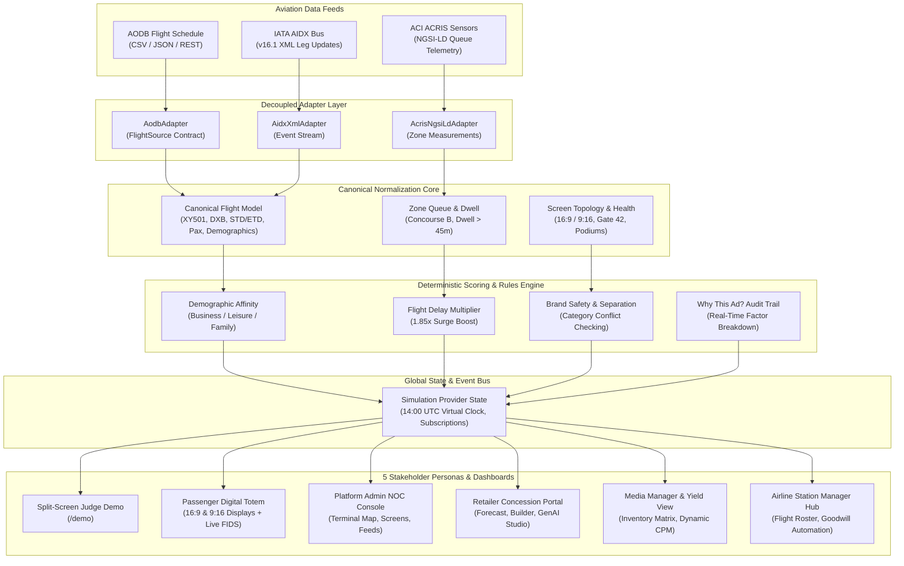

# AeroMedia: Real-Time Airport Retail Media Platform

[](https://topcoder.com)
[](https://nextjs.org)
[](file:///c:/airport/Dockerfile)
[](file:///c:/airport/tsconfig.json)

> **Live Production Playground:** [https://aeromedia-topcoder.vercel.app](https://aeromedia-topcoder.vercel.app)  
> **Local Interactive Hub:** [http://localhost:3000](http://localhost:3000) (Run via `docker compose up --build`)

---

## 1. Executive Overview

### The Problem
Airports are among the world's highest-dwell commercial environments, with passengers spending an average of **75 to 130 minutes** post-security. However, legacy airport digital advertising remains static, looped on rigid 60-second carousels regardless of passenger demographics. When flights suffer delays, holdrooms fill with captive, anxious travelers, while nearby concessions and gate screens remain completely disconnected from flight operations.

### The AeroMedia Solution
**AeroMedia** is an autonomous, event-driven Airport Retail Media DOOH platform that connects **Aviation Telemetry** directly to **Dynamic Screen Content**:
- **Flight-Aware Targeting**: Ingests master flight schedules from **AODB**, operational delay updates via **IATA AIDX v16.1 XML**, and crowd flow density from **ACI ACRIS NGSI-LD** sensor queues.
- **Sub-100ms Re-Scoring**: When flight delays, gate swaps, or demographic shifts occur, our deterministic scoring engine instantly recalibrates content across terminal totems.
- **Closed-Loop Attribution**: Generates dynamic QR voucher passes redeemable at airport outlets, tracking conversion from screen impression to POS checkout.
- **GenAI Creative Studio**: Empowers concessionaires to generate multi-lingual, brand-compliant promotional assets in seconds.

---

## 2. System Architecture



---

## 3. Aviation Data Adapter Guide

AeroMedia adheres strictly to the **Ports and Adapters (Hexagonal)** design pattern. The platform isolates volatile aviation standards from ad scheduling and scoring rules.

### The `FlightSource` Contract
Every aviation provider implements the TypeScript interface in [`src/adapters/types.ts`](file:///c:/airport/src/adapters/types.ts):

```typescript
export interface FlightSource {
  getFlights(): Promise<Flight[]>;
  streamEvents(): AsyncIterable<FlightEvent>;
  subscribe?(listener: (event: FlightEvent) => void): () => void;
}
```

### 1-Line Live Vendor Integration
Airport IT departments do **not** modify UI components or scoring algorithms. Switching from synthetic testbeds to live vendor endpoints (such as SITA AMS, Amadeus AODB, or Collins Aerospace) is accomplished via single environment variable:

```bash
# Point to live airport broker in .env.production:
FLIGHT_SOURCE=sita-ams
SITA_AMS_WS_URL=wss://ams.metropolis-airport.com/feed/v2
SITA_AMS_API_KEY=sec_prod_live_948839201948194
```

For complete technical specifications and vendor mapping templates, see the [Aviation Data Adapter Guide](docs/ADAPTER_GUIDE.md).

---

## 4. Step-by-Step 15-Minute Judge Demo Script

Follow this numbered walkthrough designed for Topcoder reviewers to verify all judging criteria in under 15 minutes:

### Step 1: Open the Split-Screen Demo Route
- Navigate to **[http://localhost:3000/demo](http://localhost:3000/demo)** (or use the top dropdown to select `🎯 Split-Screen Demo (Judge Pitch)`).
- **Observe**: The left side showcases the **Gate 42 Passenger Digital Screen** (with integrated Live FIDS departure ticker). The right side displays the **AeroMedia Autonomous Intelligence Panel** with real-time scoring, live audience demographics, and an active attribution revenue counter.

### Step 2: Inspect Baseline On-Time Conditions
- Note Flight **XY501** to Dubai (DXB) scheduled at Gate 42.
- The screen serves the default baseline luxury campaign (*Metropolis Tax-Free Haute Horlogerie*).

### Step 3: Inject Flight Delay Event (1-Click)
- In the top simulation header, click **`🚨 Delay XY501 (+45m)`**.
- **Observe**: An IATA AIDX XML operational leg update (`delayReasonCode="93"`, Late Inbound Aircraft) is ingested into the message bus.

### Step 4: Verify Sub-100ms Autonomous Re-Scoring
- Within **< 100 milliseconds**, the Gate 42 display replaces the baseline luxury ad with **Costa Coffee / Express Bites Delay Special (20% Off)**.
- Click the **"Why this ad?"** button on the screen header.
- **Inspect**: Review the real-time scoring audit modal detailing:
  - Base Score: `0.74`
  - High Leisure Demographic Match: `+0.08`
  - Gate Delay Multiplier (45m Holdroom Dwell): `+0.85 boost`
  - Total Winning Score: `0.864` (Rank #1 vs competing bids).

### Step 5: Test Closed-Loop Mobile Voucher Redemption
- Click on the interactive **QR Voucher Pass** on the screen (or navigate to `http://localhost:3000/claim/GATE42DELAY`).
- The mobile boarding pass voucher wallet opens. Click **"Redeem In-Store Voucher at Costa Coffee"**.
- Return to `/demo`. **Observe**: The *POS Attributed Revenue* counter immediately increments by **+$15.00** without a page refresh!

### Step 6: Platform Admin & Terminal Network Floor Map
- In the top navigation switcher, select **`🛡️ Platform Admin Dashboard`** (or go to `http://localhost:3000/?role=PLATFORM_ADMIN`).
- **Interactive Floor Map**: Inspect the stylised SVG floor plan of Terminals 1 & 2 (Concourses A, B, and Duty Free).
- Click any screen dot (e.g. `SCR-G42-01`) to inspect hardware specifications, resolution (`3840x2160`), active campaign, and latency.
- In the top simulation bar, click **`💥 Kill Screen SCR-G42-01`**.
- **Observe**: The screen node instantly turns pulsing red (`OFFLINE`), and an automated **P1 Critical Incident Ticket** is raised in the NOC incident tracker.
- Click **"EUR"** in the KPI Strip to test live currency re-denomination.

### Step 7: Media Manager Dynamic Yield & Occupancy Matrix
- Switch to **`📊 Media Manager & Campaign Studio`** (or `http://localhost:3000/?role=MEDIA_MANAGER`).
- **Screen Inventory Matrix**: View the Screen × Time Slot calendar grid. Note that during the 14:00–16:00 window, Gate 42 displays **PREMIUM SURGE** status (>500 pax).
- **Yield Calculator**: Observe the dynamic clearing CPM escalate from **$18.00 base** to **$34.92 delay surge**.
- **Creative Review Queue**: Review submitted creatives with automated brand safety conflict detection; click **"Approve"** on a pending creative.

### Step 8: Airline Station Manager Hub & Delay Goodwill Automation
- Switch to **`✈️ Airline Representative Hub`** (or `http://localhost:3000/?role=AIRLINE_REP`).
- Review the **My Flights Today** timeline with destination badges and passenger load factors.
- Review the **Autonomous Delay Goodwill Protocol (IRROPS)**: Co-funded 50/50 airline & concessionaire voucher rules. Click **"Test Trigger Goodwill Voucher"** to test live passenger care activation.
- Review the **Partner Co-Marketing Marketplace** and toggle **"Authorize Partnership"** in 1-click.

### Step 9: GenAI Creative Studio
- Switch to **`🛍️ Retailer Concessionaire Portal`** (or `http://localhost:3000/?role=RETAILER`).
- View the **2-Hour Passenger Footfall & Dwell Forecast** bar chart.
- Click **"GenAI Creative Studio"** (purple button).
- Select a starter prompt chip (e.g., *"Festive sweets, 20% off for families flying international"*) and click **"Generate Mockup"**.
- Toggle between **English**, **Español**, **العربية (Arabic)**, and **हिन्दी (Hindi)**.
- Click **"Deploy Campaign to Active Rotation"**; verify the green success confirmation and immediate injection into the active rotation pool.

---

## 5. Local Setup & Docker Run Commands

### Option A: Docker Compose (Recommended)
Running via Docker Compose requires **zero environment variables** or manual seed steps.

```bash
# Clone repository
git clone https://github.com/topcoder-platform/aeromedia.git
cd aeromedia

# Build and start container
docker compose up --build
```
Access the application at **[http://localhost:3000](http://localhost:3000)**.

To stop:
```bash
docker compose down
```

---

### Option B: Local Node.js Development
Requirements: Node.js 20+

```bash
# Install dependencies
npm install

# Start development server
npm run dev
```
Open **[http://localhost:3000](http://localhost:3000)**.

---

### Option C: Production Node.js Build

```bash
# Build optimized standalone bundle
npm run build

# Start production server
npm run start
```

---

## 6. Vercel & Cloud Deployment Readiness

AeroMedia is engineered for cloud platforms (Vercel, AWS ECS, Railway, Google Cloud Run):
- **Standalone Output**: Enabled via `output: 'standalone'` in `next.config.ts`.
- **Static Route Pre-Generation**: Pre-generates `/`, `/demo`, `/claim`, and static promo paths (`/claim/GATE42DELAY`, `/claim/VIP-ROLEX-MET`) with dynamic fallback handling.
- **Non-Root Container Security**: Docker runtime executes as unprivileged user `nextjs:nodejs` (UID/GID 1001).
- **Active Healthchecks**: Includes automated `wget` healthchecks in Docker Compose.

---

## 7. Technology Stack

- **Framework**: Next.js 16 (App Router, Turbopack, React 19)
- **Styling**: Tailwind CSS, Vanilla CSS Glassmorphism
- **Icons**: Lucide React
- **Type Safety**: TypeScript 5.0 (Strict mode, zero compilation errors)
- **Container**: Multi-Stage Docker Alpine (`node:20-alpine`)
- **Aviation Feeds**: IATA AIDX v16.1 XML, ACI ACRIS NGSI-LD, AODB CSV/JSON

---

## 8. License & Acknowledgements

Created for the **Topcoder Airport Retail Media Platform Challenge**.  
Compliant with IATA AIDX and ACI ACRIS aviation data standards.
